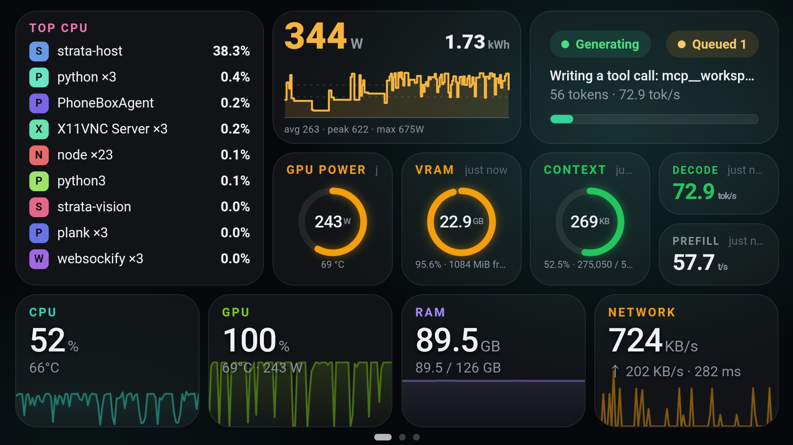

# 把一台Strata 服务器的状态搬进旧手机屏幕

本项目是基于 [ersinkoc/phonebox](https://github.com/ersinkoc/phonebox) 的修改版，使用旧手机监控 Linux 服务器上的 Strata 活动。




> 三个子系统：    
> **PhoneBox 面板**（Strata 推理服务器的 .NET agent + 一加 3T 面板 App）    
> **小米智能插座功耗上屏**（1 Hz 只读墙电/今日 kWh 波形）    
> **NAS 联动延时断电**（服务器关机时给群晖NAS发送消息，延迟180 秒后断掉服务器供电插座）。
>
> 本仓库是 2026-11-18 从运行现场（服务器 + 手机 + NAS + 插座）重新整理的，目标：照 README 从零走一遍，即可 100% 还原。  

## 1. 跑着什么（终态快照，验收基准）

| 侧     | 组件                                                                                                                   | 状态判据                                                       |
| ------ | ---------------------------------------------------------------------------------------------------------------------- | -------------------------------------------------------------- |
| 服务器 | PhoneBox agent（dotnet 10，0.9.4+fork）user 服务                                                                       | `curl 127.0.0.1:8765/api/state` 有 GPU 字段                    |
| 服务器 | `pb-strata-pushd`（1 s 常驻推送）· `pb-plug-read`（1 Hz 墙电）· `pb-chargeguard.timer`（60 s）· `pb-bootcheck`（可选） | `systemctl --user status …` 全 active；`/api/push` 恰 7 个 key |
| 服务器 | 系统钩子 `phonebox-sleep/wake`（关机熄屏/开机亮屏）· `plug-heartbeat/notify`（断电联动）                               | `systemctl is-enabled` 全 enabled                              |
| 手机   | 3T / LineageOS 18.1 / kiosk 桌面 / 在装 APK `vc31 0.9.4+fork`（md5 `2558313e…`）                                       | home 页 12 卡实时刷新；三场景见 `phone-behavior/README.md`     |
| NAS    | `plug-watcher`（DSM 7 systemd，开机自启实测过）                                                                        | journal 持续 alive；真关机 181 s 断电实测过（2026-11-17）      |
| 插座   | xiaomi.plug.04：面板读瓦数（只读）+ NAS 写开关（唯一写者）                                                             | `nas_off.py --check` 返回 CHECK_OK                             |

## 2. 全景一图

```
Strata引擎:8080 ─┐                                   ┌─ SSE 1Hz 状态帧(pushItems) ─► 3T 手机面板
plug-read 1Hz ───┼─ pb-strata-pushd 1s ─POST 8765──► PhoneBox agent ─ adb reverse ─┤   12 个控件
                 │ (7 个 push key)                   └─ 开机枚举→自动亮屏进面板      └─ 息屏/深睡策略
服务器电源 ◄── 局域网 miio（NAS 唯一写者）── 群晖 plug_watcher ◄── UDP HB/SHUTDOWN ── 服务器 heartbeat/notify
（完整数据流与实测时序：docs/ARCHITECTURE.md）
```

## 3. 目录地图

| 目录              | 是什么                                                                      | 文档                       |
| ----------------- | --------------------------------------------------------------------------- | -------------------------- |
| `app/`            | 手机 APK 源码（Android 工程；息屏/深睡/断流地板/控件字号的实现处）          | `app/README.md`            |
| `agent/`          | 服务器后台源码（.NET 10；采集/push 存储/唤醒/kiosk 协议）                   | `agent/README.md`          |
| `panel/`          | 控件数据采集脚本、两个 HTML 控件样式、页面布局快照（7 key 契约表）          | `panel/README.md`          |
| `phone-behavior/` | 充电三层策略 + 关机熄屏/开机亮屏钩子 + 深睡配套（服务器侧脚本与 unit）      | `phone-behavior/README.md` |
| `plug-control/`   | 功耗只读采集 + NAS 延时断电（server/nas 两侧）+ 属性实测表 + token 获取指南 | `plug-control/README.md`   |
| `phone-setup/`    | 裸机手机到面板机：LineageOS 刷机、kiosk、adb/udev、BIOS ErP                 | `phone-setup/README.md`    |
| `tools/`          | 构建配方（APK 全自动脚本）、上游测试/冒烟工具、脱敏还原脚本                 | `tools/README.md`          |
| `docs/`           | 架构与数据流 · 脱敏对照表 · 代码来源谱系 · 上游 CHANGELOG                   | 各自                       |
| `artifacts/`      | 当前在装的 APK（现场快照，md5 记录在案；正解仍是编译）                      | `artifacts/README.md`      |

## 4. 代码来源（必读声明）

主体来自上游开源项目 **ersinkoc/phonebox**（MIT，`LICENSE` 为原文）：`app/`+`agent/` 基线 =
上游 `d15399d`（v0.9.4），全部本地改动清单与动机见 `app/`/`agent/` README 及
`docs/UPSTREAM-CHANGELOG.md` Unreleased 节。

小米智能插座联动与全部运维脚本为独立开发；第三方素材（LineageOS、token 提取工具、python-miio、
MIoT spec、GPT 参考文档）的链接与指纹在 **`docs/CODE-SOURCES.md`**。Strata 推理引擎是外部
依赖（只消费其 `/metrics` 等 HTTP 契约），不在本仓库范围。

## 5. 脱敏与凭据（动手前先读）

服务器/NAS/插座/手机地址 → `<server-ip> <nas-ip> <plug-ip> <phone-ip>`，
用户名 → `<user> <nas-user>`，数据盘 → `<data-disk>`，adb 序列号 → `<serial>`，主机名/SSID/
坐标/插座 token → `<host> <ssid> <lat> <lon> <plug-token>`，面板 lan token 与引擎 API key →
运行时自生成/自适应。完整对照、真值存放位置（服务器
`~/.config/pb_hosts.env`、`~/.config/pb_plug.env`，NAS `plug-secret.env`，服务器
`plug-delay.env`）与还原脚本用法：**`docs/DESENSITIZATION.md`**。下面部署命令里出现的
`<...>` 都按这张表替换；提交/推送前跑一遍文档末节的 grep 自查。

## 6. 前置条件与版本钉

硬件：一台 Linux 服务器（本案例 Ubuntu 24.04 + RTX 3090 + Strata 引擎）、一台 USB 可长期
挂载的 Android 手机（本案例 3T/Lineage18.1）、一只 xiaomi.plug.04 智能插座、一台常开 NAS
（本案例群晖 DSM 7）。软件版本钉与**大型工具下载链接**（dotnet 10 / JDK17 / Android SDK35+BT34 /
gradle 8.11.1 / platform-tools / python-miio 0.5.12 / LineageOS 镜像及 md5 / token_extractor.exe
及 sha256）全部集中在 **`tools/README.md`**。BIOS：ErP 开、来电自启开（`phone-setup/README.md`）。

## 7. 从零部署（按序执行，每步细节在对应 README）

**Step 0 备料**：下载/核对 `tools/README.md` 清单里的工具与 ROM；按 `docs/DESENSITIZATION.md`
建好现场凭据文件（服务器 `pb_hosts.env`、`pb_plug.env`；NAS `plug-secret.env`；
`/usr/local/bin/plugdelay/plug-delay.env` 后建）。

**Step 1 服务器基础环境**：`apt install dotnet-sdk-10.0 openjdk-17-jdk adb fastboot`；
装两条 udev 规则并 reload（`phone-setup/udev/`）；`loginctl enable-linger <user>`；BIOS ErP。

**Step 2 agent 编译+上线**：按 `agent/README.md`（`dotnet build -c Release` → 拷 11 个产物文件
进 `~/.local/share/PhoneBox/app/` → `agent/systemd/phonebox.service` 换 `<user>` 后进
`~/.config/systemd/user/` → `enable --now`）。验收 8765 活着、`/api/state` 有 GPU。

**Step 3 手机变面板机**：按 `phone-setup/README.md`（刷机或不刷 → 首启清单：adb 授权、Root
身份调试、Wi-Fi、校时）。

**Step 4 装 APK**：最快 = 直装 `artifacts/PhoneBox-0.9.4+fork-vc31.apk`；正解 =
`tools/build-android.sh` 编译（`app/README.md`）。装完设 kiosk 桌面 + `screen_off_timeout=10000`。
验收：面板上屏、`mCurrentFocus` 为 HomeAlias。

**Step 5 息屏/唤醒钩子**：按 `phone-behavior/README.md` §1——脚本与单元里的 `<serial>`、`<user>`
都要先 sed 成真值（漏 sed 的话 `systemctl` 起不来或脚本抓不到设备），再 enable。
验收 = 文档里的“三场景”。

**Step 6 充电策略**：按 `phone-behavior/README.md` §2（同样先 sed 占位，再 user timer enable）。
验收：`pb_chargeguard.sh status` 输出阶段与日程；日志开始心跳。

**Step 7 指标采集**：按 `panel/README.md` §2（collector 进 `~/bin`、pushd unit enable）。
验收：`/api/push` 出现 4 个 strata/gpu/vram key 且每秒更新。

**Step 8 插座功耗采集**：先按 `plug-control/docs/token-extraction.md` 拿 `<plug-ip>+<plug-token>`；
再按 `plug-control/README.md` “部署 A”（venv、env、reader unit）。验收：keys 里多出 `plug_power`。

**Step 9 NAS 延时断电**：按 `plug-control/README.md` “部署 B/C”（服务器两 unit + NAS watcher；
**先保持 dry-run**）。验收：短阈值三路测试（失联 FIRE / 握手 FIRE / rearm）→ 改回 180 →
`PLUG_OFF_CMD` 换真命令 → 一次真 `poweroff` 复现“握手+181 s 断电+来电自启回来”。

**Step 10 控件与布局上屏**：按 `panel/README.md` §3——回植快照（两个 HTML 全文
粘贴；三个 gauge 的 max=24/512/350）。验收 = 第 1 节状态表的手机侧各行 + 截屏比对
（home 12 卡、数字 1 s 一跳、墙电阶梯波在爬）。

## 8. 日常运维速查

改阈值：全在各脚本**文件头常量**（`panel/README.md` §1 列了位置），改完
`systemctl --user restart pb-strata-pushd` 即生效（reader/chargeguard 同理 restart）。
换面板布局：在 8765 改完记得重跑快照（脱敏后覆盖 `panel/layout/`，纪律见 `panel/README.md`）。
单组件回滚一行：见各 README 末节；agent 换代用 `cp --remove-destination`。
重启次序无要求：agent↔APK 协议双向兼容；pushd 依赖 agent（unit 已 After=phonebox.service）；
断电联动依赖 NAS 常开。插座换型号：先跑 `plug-control/power-read/probe/plug_probe.py` 重新验
属性，再改 reader/push 脚本的 siid/piid（只有一处）。
排障取数口：`/api/state|push|phones|lan`、`journalctl --user -u pb-*`、
`adb exec-out screencap -p`、NAS `journalctl -u plug-watcher`。

## 9. 测试与验证

`cd agent && dotnet test -c Release PhoneBox.Agent.Tests`（331 全绿=验收线；**agent/ 没有 sln，
build/test 都必须指到工程目录**，裸 `dotnet build` 会 MSB1003）；`tools/smoke-agent.py` 冒烟真 agent；
`tools/ui-tests` 跑上游面板回归（demo-server 假 agent，离线可跑）；chargeguard 用
`PB_ONESHOT` 注入验状态机（`phone-behavior/README.md`）；plug-delay 用短阈值三路与真关机；
手机行为用三场景。**每次改动后的最小验收**：push keys 数量与节奏、三场景、
`nas_off.py --check`、一次真 reboot。

## 10. 边界与已知事项

Strata 引擎没跑时 strata_* 断供、其余照常；1 Hz UDP 的 24 h 长跑稳定性在观察；NAS 上 nas_off 三件套仍是现场硬编码旧版（等价未迁移，见 `plug-control/README.md` 末节）；
agent 原地重启（非 reboot）后手机若已深睡需等一个 doze 维护窗/分钟级自愈；

